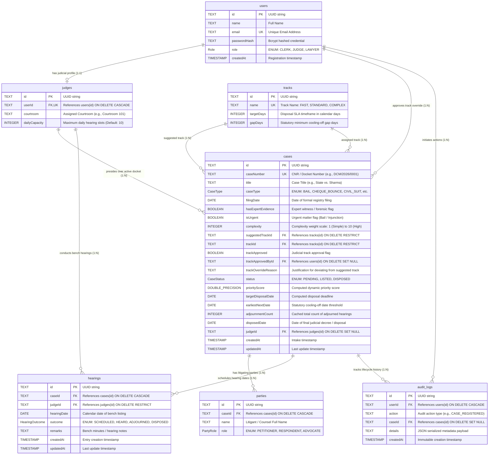

# Deliverable 2: Entity-Relationship (ER) Diagram & Data Model

**System**: NyayaKram — District Court Case Flow Management System (DCFM)  
**Database**: PostgreSQL 16 (Hosted on Neon Serverless)  
**Entities Modeled**: 7 Relational Tables (`users`, `judges`, `tracks`, `cases`, `parties`, `hearings`, `audit_logs`)  

---

## 1. Complete Mermaid Entity-Relationship (ER) Diagram



---

## 2. PostgreSQL Enumeration Types (ENUMs)

To maintain strict domain constraints and prevent invalid string inputs, five domain-specific PostgreSQL enum types are defined:

```sql
CREATE TYPE "Role" AS ENUM ('CLERK', 'JUDGE', 'LAWYER');
CREATE TYPE "CaseStatus" AS ENUM ('PENDING', 'LISTED', 'DISPOSED');
CREATE TYPE "HearingOutcome" AS ENUM ('SCHEDULED', 'HEARD', 'ADJOURNED', 'DISPOSED');
CREATE TYPE "PartyRole" AS ENUM ('PETITIONER', 'RESPONDENT', 'ADVOCATE');
CREATE TYPE "CaseType" AS ENUM (
    'BAIL', 
    'CHEQUE_BOUNCE', 
    'RENT_DISPUTE', 
    'CIVIL_SUIT', 
    'COMMERCIAL_DISPUTE', 
    'PROPERTY_DISPUTE'
);
```

---

## 3. Detailed Entity Dictionary & Constraints

### 3.1 Table: `users`
Stores user identities, administrative credentials, and system roles.
- **`id`** (`TEXT`, PRIMARY KEY): UUID v4 identifier.
- **`name`** (`TEXT`, NOT NULL): Full legal name of court staff or legal counsel.
- **`email`** (`TEXT`, NOT NULL, UNIQUE): Unique email used for authentication and notifications.
- **`passwordHash`** (`TEXT`, NOT NULL): 60-character bcrypt cryptographic hash.
- **`role`** (`Role`, NOT NULL): User authorization tier (`CLERK`, `JUDGE`, `LAWYER`).
- **`createdAt`** (`TIMESTAMP(3)`, NOT NULL, DEFAULT `CURRENT_TIMESTAMP`).

### 3.2 Table: `judges`
Stores judicial bench details, courtroom allocations, and daily scheduling capacity limits.
- **`id`** (`TEXT`, PRIMARY KEY): UUID v4 identifier.
- **`userId`** (`TEXT`, NOT NULL, UNIQUE): 1:1 foreign key referencing `users(id)` with `ON DELETE CASCADE`.
- **`courtroom`** (`TEXT`, NOT NULL): Designated courtroom identifier (e.g., `"Courtroom 101"`).
- **`dailyCapacity`** (`INTEGER`, NOT NULL, DEFAULT `10`): Maximum number of cases scheduled per day to prevent judicial overbooking.

### 3.3 Table: `tracks`
Defines DCFM classification rules, statutory disposal targets, and cooling intervals.
- **`id`** (`TEXT`, PRIMARY KEY): UUID v4 identifier.
- **`name`** (`TEXT`, NOT NULL, UNIQUE): Distinct track designation (`'FAST'`, `'STANDARD'`, `'COMPLEX'`).
- **`targetDays`** (`INTEGER`, NOT NULL): Disposal timeframe SLA in days (FAST: 90, STANDARD: 365, COMPLEX: 730).
- **`gapDays`** (`INTEGER`, NOT NULL): Statutory minimum cooling-off gap days required between consecutive hearings (FAST: 7, STANDARD: 21, COMPLEX: 45).

### 3.4 Table: `cases`
The central operational entity representing court cases, tracking status, priority, and assignment.
- **`id`** (`TEXT`, PRIMARY KEY): UUID v4 identifier.
- **`caseNumber`** (`TEXT`, NOT NULL, UNIQUE): Case registry number (e.g., `"DCM/2026/0001"`).
- **`title`** (`TEXT`, NOT NULL): Title of the matter (e.g., `"State of Delhi vs. Rakesh Sharma"`).
- **`caseType`** (`CaseType`, NOT NULL): Substantive legal classification.
- **`filingDate`** (`DATE`, NOT NULL, DEFAULT `CURRENT_DATE`): Date the matter was officially filed.
- **`hasExpertEvidence`** (`BOOLEAN`, NOT NULL, DEFAULT `false`): Flag indicating forensic/expert testimony.
- **`isUrgent`** (`BOOLEAN`, NOT NULL, DEFAULT `false`): Statutory urgency indicator.
- **`complexity`** (`INTEGER`, NOT NULL): Case complexity score on a scale of 1 to 10.
- **`suggestedTrackId`** (`TEXT`, NOT NULL): Foreign key referencing `tracks(id)` (`ON DELETE RESTRICT`).
- **`trackId`** (`TEXT`, NOT NULL): Effective track foreign key referencing `tracks(id)` (`ON DELETE RESTRICT`).
- **`trackApproved`** (`BOOLEAN`, NOT NULL, DEFAULT `false`): Flag indicating judicial sign-off on the track.
- **`trackApprovedById`** (`TEXT`, NULL): Foreign key referencing `users(id)` (`ON DELETE SET NULL`).
- **`trackOverrideReason`** (`TEXT`, NULL): Judicial justification if assigned track differs from suggested track.
- **`status`** (`CaseStatus`, NOT NULL, DEFAULT `'PENDING'`): Current case status (`'PENDING'`, `'LISTED'`, `'DISPOSED'`).
- **`priorityScore`** (`DOUBLE PRECISION`, NOT NULL, DEFAULT `0`): Calculated dynamic scheduling score.
- **`targetDisposalDate`** (`DATE`, NOT NULL): Target completion date (`filingDate + targetDays`).
- **`earliestNextDate`** (`DATE`, NOT NULL): Earliest allowable next hearing date.
- **`adjournmentCount`** (`INTEGER`, NOT NULL, DEFAULT `0`): Cached count of adjourned hearings.
- **`disposedDate`** (`DATE`, NULL): Date of final order/judgment.
- **`judgeId`** (`TEXT`, NULL): Assigned presiding judge referencing `judges(id)` (`ON DELETE SET NULL`).
- **`createdAt`** (`TIMESTAMP(3)`, NOT NULL, DEFAULT `CURRENT_TIMESTAMP`).
- **`updatedAt`** (`TIMESTAMP(3)`, NOT NULL).

### 3.5 Table: `parties`
Maintains individual litigating entities and counsel associated with each case.
- **`id`** (`TEXT`, PRIMARY KEY): UUID v4 identifier.
- **`caseId`** (`TEXT`, NOT NULL): Foreign key referencing `cases(id)` (`ON DELETE CASCADE`).
- **`name`** (`TEXT`, NOT NULL): Full name of individual, corporate entity, or state department.
- **`role`** (`PartyRole`, NOT NULL): Party designation (`'PETITIONER'`, `'RESPONDENT'`, `'ADVOCATE'`).

### 3.6 Table: `hearings`
Records court listings, scheduled dates, bench minutes, and hearing outcomes.
- **`id`** (`TEXT`, PRIMARY KEY): UUID v4 identifier.
- **`caseId`** (`TEXT`, NOT NULL): Foreign key referencing `cases(id)` (`ON DELETE CASCADE`).
- **`judgeId`** (`TEXT`, NOT NULL): Foreign key referencing `judges(id)` (`ON DELETE RESTRICT`).
- **`hearingDate`** (`DATE`, NOT NULL): Calendar date of the scheduled bench sitting.
- **`outcome`** (`HearingOutcome`, NOT NULL, DEFAULT `'SCHEDULED'`): Hearing status (`'SCHEDULED'`, `'HEARD'`, `'ADJOURNED'`, `'DISPOSED'`).
- **`remarks`** (`TEXT`, NULL): Bench remarks, orders passed, or grounds for adjournment.
- **`createdAt`** (`TIMESTAMP(3)`, NOT NULL, DEFAULT `CURRENT_TIMESTAMP`).
- **`updatedAt`** (`TIMESTAMP(3)`, NOT NULL).

### 3.7 Table: `audit_logs`
Immutable forensic audit trail recording every administrative and judicial event.
- **`id`** (`TEXT`, PRIMARY KEY): UUID v4 identifier.
- **`userId`** (`TEXT`, NOT NULL): Foreign key referencing `users(id)` (`ON DELETE CASCADE`).
- **`action`** (`TEXT`, NOT NULL): Action identifier (e.g., `'CASE_REGISTERED'`, `'TRACK_CHANGED'`, `'HEARING_RESULT'`).
- **`caseId`** (`TEXT`, NULL): Foreign key referencing `cases(id)` (`ON DELETE SET NULL`).
- **`details`** (`TEXT`, NOT NULL): JSON serialized metadata payload recording state before and after change.
- **`createdAt`** (`TIMESTAMP(3)`, NOT NULL, DEFAULT `CURRENT_TIMESTAMP`).

---

## 4. Relationship Cardinality & Referential Actions Summary

| Parent Table | Child Table | Relationship | Foreign Key Column | On Delete Action | On Update Action | Rationale |
| :--- | :--- | :--- | :--- | :--- | :--- | :--- |
| `users` | `judges` | 1 : 1 | `judges.userId` | **`CASCADE`** | `CASCADE` | If a user account is removed, its judicial bench profile is cleaned up. |
| `users` | `cases` | 1 : N | `cases.trackApprovedById`| **`SET NULL`** | `CASCADE` | Preserves case record if the approving judge user account is decommissioned. |
| `users` | `audit_logs` | 1 : N | `audit_logs.userId` | **`CASCADE`** | `CASCADE` | Relates forensic logs to user accounts. |
| `judges` | `cases` | 1 : N | `cases.judgeId` | **`SET NULL`** | `CASCADE` | Reallocating or retiring a judge unassigns cases without deleting them. |
| `judges` | `hearings` | 1 : N | `hearings.judgeId` | **`RESTRICT`** | `CASCADE` | Prevents deleting a judge record while active hearing proceedings exist. |
| `tracks` | `cases` | 1 : N | `cases.suggestedTrackId`| **`RESTRICT`** | `CASCADE` | Prevents deleting core DCFM track rules while cases reference them. |
| `tracks` | `cases` | 1 : N | `cases.trackId` | **`RESTRICT`** | `CASCADE` | Guarantees every case is bound to an active statutory track. |
| `cases` | `parties` | 1 : N | `parties.caseId` | **`CASCADE`** | `CASCADE` | Litigating party records exist only within the context of their case. |
| `cases` | `hearings` | 1 : N | `hearings.caseId` | **`CASCADE`** | `CASCADE` | Deleting a test/cancelled case cleans up all associated scheduled hearings. |
| `cases` | `audit_logs` | 1 : N | `audit_logs.caseId` | **`SET NULL`** | `CASCADE` | Retains audit history even if a test case is removed from the docket. |
