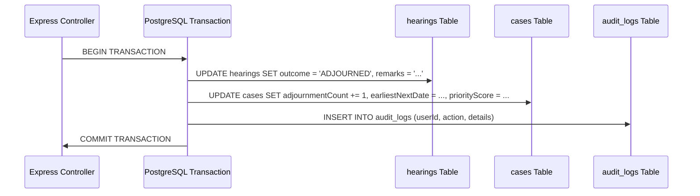

# Deliverable 7: Backend Integration & ORM Architecture

**System**: NyayaKram — District Court Case Flow Management System (DCFM)  
**Data Access Layer**: Prisma ORM `v5.22.0` with PostgreSQL Engine  
**Server Environment**: Node.js `v20.x` & Express.js  

---

## 1. Architectural Overview

NyayaKram connects its Express.js REST application layer to Neon Serverless PostgreSQL using **Prisma ORM**. Prisma acts as a type-safe data access client providing:
1. **Declarative Data Modeling**: Synchronizing database DDL migrations with JavaScript/TypeScript object models (`schema.prisma`).
2. **Connection Lifecycle Management**: Handling pooled connections to Neon's PgBouncer pooler while gracefully handling idle scale-to-zero TCP drops.
3. **Atomic Transaction Pipelines**: Executing multi-table mutations within `prisma.$transaction()` to guarantee mathematical consistency across denormalized fields and audit logs.
4. **Role-Based Access Control (RBAC)**: Enforcing data-access boundaries before queries reach the database layer.

---

## 2. Serverless Connection Resilience (`prisma.js`)

In serverless PostgreSQL environments, compute nodes scale down after idle timeouts, causing subsequent queries to encounter closed TCP connections (`P1017` error). 

In `server/src/utils/prisma.js`, NyayaKram implements a singleton client wrapped with a transparent single-retry handler:

```javascript
// server/src/utils/prisma.js
import { PrismaClient } from '@prisma/client';

const globalForPrisma = globalThis;

export const prisma =
  globalForPrisma.prisma ??
  new PrismaClient({
    log: process.env.NODE_ENV === 'development' ? ['warn', 'error'] : ['error'],
  });

if (process.env.NODE_ENV !== 'production') {
  globalForPrisma.prisma = prisma;
}

/**
 * Executes a Prisma operation with automatic retry on transient connection drops
 * (e.g. Neon scale-to-zero idle connection drops / P1017)
 */
export async function withRetry(operation, maxRetries = 1, delayMs = 300) {
  let attempt = 0;
  while (attempt <= maxRetries) {
    try {
      return await operation();
    } catch (err) {
      const isConnectionError =
        err?.code === 'P1017' || // Server has closed the connection
        err?.message?.includes('kind: Closed') ||
        err?.message?.includes('Connection pool timeout');

      if (isConnectionError && attempt < maxRetries) {
        attempt++;
        await new Promise((resolve) => setTimeout(resolve, delayMs));
        // Force reconnect by refreshing the connection pool
        await prisma.$disconnect().catch(() => {});
        await prisma.$connect().catch(() => {});
        continue;
      }
      throw err;
    }
  }
}
```

---

## 3. CRUD Data Operations via Prisma

### 3.1 Case Registration (Create with Automated Track Assignment)
When a court clerk registers a new case, the backend calculates target disposal dates, evaluates initial priority score, and inserts the case along with its litigating parties:

```javascript
// POST /api/cases
export async function registerCase(req, res) {
  const { title, caseType, isUrgent, complexity, parties } = req.body;
  const clerkUserId = req.user.id;

  // 1. Determine suggested track based on case type & complexity
  const track = await prisma.track.findFirst({
    where: { name: determineTrack(caseType, complexity) }
  });

  const filingDate = new Date();
  const targetDisposalDate = new Date(filingDate.getTime() + track.targetDays * 86400000);
  const earliestNextDate = new Date(filingDate.getTime() + track.gapDays * 86400000);
  const initialPriority = calculatePriorityScore({ filingDate, targetDays: track.targetDays, complexity, isUrgent });

  // 2. Insert Case, Parties, and Audit Log atomically
  const newCase = await prisma.$transaction(async (tx) => {
    const createdCase = await tx.case.create({
      data: {
        caseNumber: await generateNextCNR(tx),
        title,
        caseType,
        isUrgent,
        complexity,
        suggestedTrackId: track.id,
        trackId: track.id,
        targetDisposalDate,
        earliestNextDate,
        priorityScore: initialPriority,
        parties: {
          create: parties.map(p => ({ name: p.name, role: p.role }))
        }
      },
      include: { parties: true, track: true }
    });

    await tx.auditLog.create({
      data: {
        userId: clerkUserId,
        caseId: createdCase.id,
        action: 'CASE_REGISTERED',
        details: JSON.stringify({ caseNumber: createdCase.caseNumber, complexity, priorityScore: initialPriority })
      }
    });

    return createdCase;
  });

  return res.status(201).json(newCase);
}
```

### 3.2 High-Speed Cause List Generation (Read with Filtering & Index Utilization)
Leverages the composite index `"cases_status_priorityScore_idx"`:

```javascript
// GET /api/cases/cause-list
export async function getCauseList(req, res) {
  const { judgeId, date } = req.query;

  const causeList = await prisma.case.findMany({
    where: {
      status: { in: ['PENDING', 'LISTED'] },
      ...(judgeId ? { judgeId } : {}),
      OR: [
        { isUrgent: true },
        { earliestNextDate: { lte: new Date(date) } }
      ]
    },
    include: {
      track: { select: { name: true, targetDays: true } },
      judge: { select: { courtroom: true } },
      parties: { select: { name: true, role: true } }
    },
    orderBy: { priorityScore: 'desc' },
    take: 25
  });

  return res.json(causeList);
}
```

---

## 4. Atomic Multi-Entity Transactions (`prisma.$transaction`)

When a judge delivers an order on a scheduled hearing, multiple interdependent entities must be updated in unison. If any operation fails, the entire transaction rolls back cleanly:



```javascript
// PATCH /api/hearings/:id/outcome
export async function recordHearingOutcome(req, res) {
  const { id: hearingId } = req.params;
  const { outcome, remarks } = req.body;
  const judgeUserId = req.user.id;

  const result = await prisma.$transaction(async (tx) => {
    // 1. Update hearing outcome
    const hearing = await tx.hearing.update({
      where: { id: hearingId },
      data: { outcome, remarks },
      include: { case: { include: { track: true } } }
    });

    const targetCase = hearing.case;

    // 2. Branch logic based on outcome
    if (outcome === 'DISPOSED') {
      await tx.case.update({
        where: { id: targetCase.id },
        data: {
          status: 'DISPOSED',
          disposedDate: new Date(),
          updatedAt: new Date()
        }
      });
    } else if (outcome === 'ADJOURNED') {
      const updatedAdjournments = targetCase.adjournmentCount + 1;
      const nextCoolingDate = new Date(Date.now() + targetCase.track.gapDays * 86400000);
      const recalculatedScore = calculatePriorityScore({
        filingDate: targetCase.filingDate,
        targetDays: targetCase.track.targetDays,
        complexity: targetCase.complexity,
        adjournmentCount: updatedAdjournments,
        isUrgent: targetCase.isUrgent
      });

      await tx.case.update({
        where: { id: targetCase.id },
        data: {
          status: 'PENDING',
          adjournmentCount: updatedAdjournments,
          earliestNextDate: nextCoolingDate,
          priorityScore: recalculatedScore,
          updatedAt: new Date()
        }
      });
    }

    // 3. Append forensic audit log
    await tx.auditLog.create({
      data: {
        userId: judgeUserId,
        caseId: targetCase.id,
        action: `HEARING_${outcome}`,
        details: JSON.stringify({ hearingId, outcome, remarks })
      }
    });

    return hearing;
  });

  return res.json({ success: true, hearing: result });
}
```

---

## 5. Referential Integrity & Cascade Behavior Verification

Foreign key constraints defined in `schema.prisma` and applied via SQL DDL dictate how dependent rows respond when a parent record is mutated:

```prisma
model Case {
  id       String    @id @default(uuid())
  parties  Party[]   // ON DELETE CASCADE
  hearings Hearing[] // ON DELETE CASCADE
  auditLogs AuditLog[] // ON DELETE SET NULL
  judge    Judge?    @relation(fields: [judgeId], references: [id], onDelete: SetNull)
  track    Track     @relation(fields: [trackId], references: [id], onDelete: Restrict)
}
```

- **`ON DELETE CASCADE` (`parties`, `hearings`)**: If a draft or misfiled case is purged, all associated party records and scheduled bench hearings are automatically removed by PostgreSQL, preventing orphaned child tuples.
- **`ON DELETE SET NULL` (`audit_logs`, `cases.judgeId`)**: If a judge is transferred to another court jurisdiction, their assigned cases remain intact with `judgeId = NULL` awaiting bench reassignment. Likewise, audit logs retain historical actions even if the referenced case is expunged.
- **`ON DELETE RESTRICT` (`tracks`)**: The database engine rejects any attempt to drop or delete a DCFM track (`FAST`, `STANDARD`, `COMPLEX`) as long as at least one active case references it.

---

## 6. Role-Based Access Control (RBAC) Middleware

Before database queries execute, express middleware authenticates JWT tokens and validates that the acting user holds sufficient authority:

```javascript
// server/src/middleware/auth.js
import jwt from 'jsonwebtoken';

export function authenticateToken(req, res, next) {
  const authHeader = req.headers['authorization'];
  const token = authHeader && authHeader.split(' ')[1];

  if (!token) {
    return res.status(401).json({ error: 'Access denied: No authorization token provided' });
  }

  jwt.verify(token, process.env.JWT_SECRET, (err, user) => {
    if (err) return res.status(403).json({ error: 'Invalid or expired token' });
    req.user = user; // { id, email, role: 'CLERK' | 'JUDGE' | 'LAWYER' }
    next();
  });
}

export function authorizeRoles(...allowedRoles) {
  return (req, res, next) => {
    if (!req.user || !allowedRoles.includes(req.user.role)) {
      return res.status(403).json({ 
        error: `Unauthorized: Role '${req.user?.role}' does not have permission to execute this operation` 
      });
    }
    next();
  };
}
```

### Route Protection Matrix:
```javascript
// Clerk intake route: accessible only to CLERK
router.post('/cases', authenticateToken, authorizeRoles('CLERK'), registerCase);

// Track override and hearing disposal: accessible only to JUDGE
router.patch('/cases/:id/track-override', authenticateToken, authorizeRoles('JUDGE'), overrideTrack);
router.patch('/hearings/:id/outcome', authenticateToken, authorizeRoles('JUDGE'), recordHearingOutcome);

// Cause list lookup: accessible to CLERK, JUDGE, and LAWYER
router.get('/cases/cause-list', authenticateToken, authorizeRoles('CLERK', 'JUDGE', 'LAWYER'), getCauseList);
```
